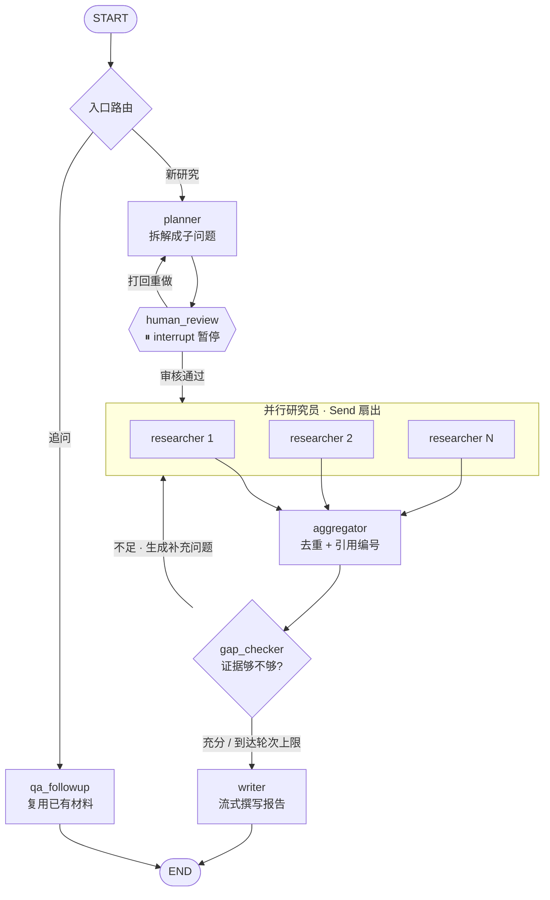

# DeepResearch Agent

> 基于 LangGraph 的多智能体深度研究助手。
> 输入一个问题，自动拆解 → 人工审核 → 并行检索 → 自我检查 → 输出**带引用、可溯源**的研究报告。

[](https://www.python.org/)
[](https://langchain-ai.github.io/langgraph/)
[](https://python.langchain.com/)
[](https://platform.deepseek.com/)
[](https://tavily.com/)
[](https://streamlit.io/)

---

## 这是什么

一个能**自己做研究**的智能体。你给一个问题，它花 2–4 分钟：

1. 把问题拆成 3–5 个可独立检索的子问题
2. **暂停下来请你审核**（可以改、可以打回）
3. 把子问题**并行**派给多个研究员，各自搜索、读网页、提炼证据
4. 汇总去重、给每个来源分配引用编号
5. **自我检查**：证据够不够？不够就生成补充问题再来一轮
6. 撰写带 `[1][2][3]` 引用的 Markdown 报告

**和普通 AI 问答的区别**：每一条结论都附原文引用片段和来源链接，可以逐条核验。

---

## 核心特性 ↔ LangGraph 概念

这张表是项目的技术地图 —— 每个功能都对应一个 LangGraph 的具体机制。

| 功能 | 用到的 LangGraph 能力 | 代码位置 |
|---|---|---|
| 状态类型与合并规则 | `TypedDict` + `Annotated[list, operator.add]` reducer | [graph/state.py](graph/state.py) |
| 规划与结构化输出 | 节点 + `.with_structured_output()` | [graph/nodes.py](graph/nodes.py) |
| **人工审核（人在回路）** | `interrupt()` + `Command(resume=...)` | [graph/nodes.py](graph/nodes.py) |
| **并行检索** | `Send` API 动态扇出 + 子图 | [graph/routers.py](graph/routers.py) |
| 研究员自主决策 | `bind_tools` + `ToolNode` + 条件边构成 ReAct 循环 | [graph/subgraphs/researcher.py](graph/subgraphs/researcher.py) |
| 子图状态隔离 | 独立 `StateGraph` + `output_schema` | [graph/state.py](graph/state.py) |
| 证据去重编号 | 单写者节点 + `Overwrite` 绕过 reducer | [graph/nodes.py](graph/nodes.py) |
| **自我反思与有界循环** | 条件边 + 迭代计数 + 三重熔断 | [graph/routers.py](graph/routers.py) |
| **断点续跑 / 多轮追问** | `SqliteSaver` + `thread_id` | [utils/checkpointer.py](utils/checkpointer.py) |
| 实时进度与流式报告 | `get_stream_writer` + `stream_mode=["updates","custom"]` + `subgraphs=True` | [cli.py](cli.py) |
| 失败自动恢复 | 自定义 `RetryPolicy` | [utils/retry.py](utils/retry.py) |
| 全链路可观测 | LangSmith tracing | [utils/tracing.py](utils/tracing.py) |

---

## 架构



**三个关键设计点**：

- **`human_review` 是图上的一个节点，不是 UI 层的一个 `if`** —— 所以它能暂停、能跨进程恢复
- **`gap_checker → researchers` 是一条循环边** —— 这是自我反思的实现，也是「知道自己不知道」的地方
- **循环有三重熔断**：`max_iterations`（业务上限）+ `recursion_limit`（LangGraph 硬顶）+ 补充问题为空时强制退出

---

## 快速开始

### 1. 环境

```bash
conda create -n deepresearch python=3.13
conda activate deepresearch
pip install -r requirements.txt
```

> 本项目在 **Python 3.13 + LangGraph 1.1** 上开发验证。

### 2. 配置密钥

```bash
cp .env.example .env
```

需要填三个（都提供免费额度）：

| 变量 | 用途 | 申请地址 |
|---|---|---|
| `DEEPSEEK_API_KEY` | 主力模型 | https://platform.deepseek.com/ |
| `TAVILY_API_KEY` | 联网搜索（1000 credits/月免费） | https://app.tavily.com/ |
| `LANGSMITH_API_KEY` | 可观测性（可选，但不填就没有 trace） | https://smith.langchain.com/ |

自检：

```bash
python scripts/check_env.py
```

### 3. 运行

```bash
# 命令行
python cli.py "RAG 与长上下文模型在知识问答场景下该如何选择"

# Web 界面
streamlit run app.py

# LangGraph Studio（可视化调试、时间旅行）
langgraph dev
```

---

## 实际效果

一次真实运行（主题：*RAG 与长上下文模型在知识问答场景下该如何选择*）：

```
✓ 节点 planner 执行完毕
⏸  请审核研究计划                    ← interrupt 暂停，等待人工确认
✓ 节点 researcher 执行完毕   × 5     ← 5 个分支并行
· 汇总（第 1 轮）：63 条证据来自 21 个页面，已分配引用编号
· 正在检查证据是否充分（第 1 轮）…
· 证据充分，开始撰写报告
· 正在撰写报告…

完成
  证据      : 63 条，来自 21 个页面
  研究报告  : 7327 字
  研究轮次  : 1 轮

── 引用完整性（机器校验）──
  正文引用编号 : 18 个，范围 1~21
  编造的编号   : 无 ✓
```

完整报告见 [examples/sample_report.md](examples/sample_report.md)。

---

## 项目结构

```
agent_hx/
├─ cli.py                      # CLI 入口：流式进度 / 审核交互 / 断点续跑
├─ app.py                      # Streamlit 入口
├─ langgraph.json              # LangGraph Studio 配置
│
├─ graph/                      # 图定义（核心）
│   ├─ state.py                #   ★ 状态 schema 与 reducer 规则
│   ├─ nodes.py                #   所有节点
│   ├─ routers.py              #   ★ 所有条件边（控制流都在这里）
│   ├─ build.py                #   ★ 集中装配
│   └─ subgraphs/researcher.py #   ★ 检索子图（ReAct 循环）
│
├─ schemas/research.py         # Pydantic 数据模型（结构化输出的契约）
├─ tools/search_tools.py       # Tavily 工具封装（重试 + 降级）
├─ prompts/                    # 提示词（每个角色一个文件）
├─ config/                     # YAML 配置（模型 / 流程 / 搜索 / 提示词）
├─ utils/                      # 配置、日志、检查点、重试、报告、编码
├─ ui/streamlit_app.py         # Streamlit 界面
├─ scripts/                    # 环境自检 / 图可视化
├─ learn/                      # 学习过程中写的验证脚本
├─ docs/                       # 架构说明与学习笔记
└─ examples/sample_report.md   # 真实生成的报告
```

---

## 关键实现

### 1. 并行扇出：一个子问题 = 一个分支

```python
# graph/routers.py
def dispatch_all(state):
    return [
        Send("researcher", {"topic": state["topic"], "sub_question": q, "round": 1})
        for q in state["plan"].sub_questions
    ]
```

条件边函数返回 `Send` 列表时，LangGraph 会为每个 `Send` 创建一个**并发分支**。
这些分支在同一超步内执行，互相看不见对方的中间结果。

**代价**：分支写的状态字段必须有 reducer，否则 `InvalidUpdateError`。

### 2. 人工审核：图上的暂停点

```python
# graph/nodes.py
answer = interrupt({
    "type": "plan_review",
    "sub_questions": plan.sub_questions,
})
# ... 用户回答后从这里继续
```

`interrupt()` 之前**不能有任何副作用** —— 恢复执行时整个节点会从头重跑。

跨进程恢复靠检查点：

```python
# 第一次进程停在这里退出，第二天换个进程也能接着审批
saved = graph.get_state(config)
if saved.interrupts:
    graph.stream(Command(resume=用户的回答), config)
```

### 3. 子图：状态隔离与显式出参

```python
# graph/subgraphs/researcher.py
builder = StateGraph(ResearcherState, output_schema=ResearcherOutput)
return builder.compile()          # ★ 不传 checkpointer
```

`output_schema` 是关键：不加的话，子图会把**整个最终状态**交回父图 ——
包括 `topic` 这类只打算当输入的字段。N 个并行分支各写一次 `topic`，
父图又没有它的 reducer，直接 `InvalidUpdateError`。

---

## 踩坑记录


### LangGraph 1.x 与中文博客的代差

绝大多数中文教程还停留在 0.x，照抄会直接报错：

| 0.x 写法 | 1.x 正确写法 |
|---|---|
| `from langgraph.checkpoint.memory import MemorySaver` | `InMemorySaver` |
| `from langgraph.prebuilt import create_react_agent` | `from langchain.agents import create_agent` |
| `from langgraph.types import get_stream_writer` | **`from langgraph.config import`**（`types` 里没有） |
| 子图 `compile(checkpointer=...)` | 子图**绝不能**自带 checkpointer |

### 静默失败：不报错，但结果是错的

这类 bug 比抛异常危险得多。本项目遇到三个：

| 场景 | 表现 |
|---|---|
| 子图出参 key 拼错 | 输出被**静默丢弃**，只发现证据是空的 |
| 自己发明 `__delete__` 想清空字段 | LangGraph **静默忽略**，列表翻倍 |
| 条件边返回空列表 | 图**静默终止**，没有报告也没有错误 |

> **写校验逻辑时先问：「什么情况下它会必然通过？」**
> 一个永远通过的校验器，比没有校验器更糟 —— 它给你虚假的安全感。

### 重试救不了确定性失败

`RetryPolicy(max_attempts=3)` 挂上去之后，某次运行仍然崩了：

```
ValidationError: List should have at most 12 items after validation, not 13
```

排查发现 **`pydantic.ValidationError` 继承自 `ValueError`**，而 LangGraph 的
`default_retry_on` 把 `ValueError` 列入「代码写错了，不重试」名单 ——
**所以重试保护静默失效了。**

修好之后（自定义 `retry_on`）又跑一次，还是崩：

```
节点调用次数: 3   ← 重试确实跑了 3 次
```

**因为这是确定性失败**：模型不是偶尔给 13 条，是每次都给 13 条 ——
问题出在 `max_length=12` 这个约束本身。

> **遇到失败先问「重试有用吗」。** 有用 → 加 retry；没用 → 修根因。
> 把确定性失败当成偶发失败去重试，是种很常见的浪费。


### 成本控制：一次实测带来 26 倍差距

Tavily 的 `TavilyExtract` 不传 `query` 时返回整页转换结果：

| 方式 | 返回长度 | 开头内容 |
|---|---|---|
| 不传 `query` | **54,085** 字符 | 「CSDN首页 博客 下载 社区」导航栏 |
| `query` + `chunks_per_source=3` | **2,106** 字符 | 正文 |

**必须传 `query`。** 否则 5 个子问题 × 3 个网页 = 45 万 token，大部分烧在导航栏上。

另外 `extract_depth: basic` 在 JS 渲染的站点上会直接失败（实测官方文档站抓不到），
必须用 `advanced`。

---

